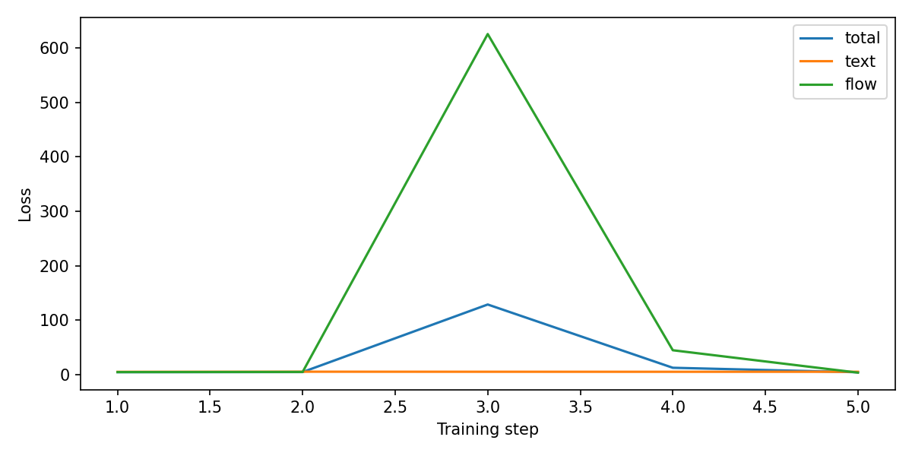

# Transfusion Reproduction

텍스트의 next-token loss와 이미지의 flow loss를 한 Transformer에서 학습하는 Transfusion 논문 재현 프로젝트입니다.
COCO 이미지·캡션과 Stable Diffusion VAE를 연결했습니다. TinyLlama에서는 tokenizer만 사용하며, 언어모델 가중치를 불러오지는 않습니다.
핵심 모델은 [lucidrains/transfusion-pytorch](https://github.com/lucidrains/transfusion-pytorch)의 구현입니다.

## 실행

Python 3.13.2에서 아래 패키지와 작은 결합 학습 검사를 확인했습니다. COCO 전체 학습에는 별도 데이터와 GPU가 필요합니다.

```bash
python -m venv .venv
# Windows: .venv\Scripts\activate
# macOS/Linux: source .venv/bin/activate
python -m pip install -r requirements.txt
```

먼저 데이터나 사전학습 모델을 받지 않는 검사를 실행할 수 있습니다. 작은 무작위 latent와 텍스트로 결합 손실·역전파·체크포인트를 확인합니다.

```bash
python transfusion-repro/main.py --smoke-test --max-steps 5 --batch-size 2 --results-dir results/smoke
```

[COCO 준비](data/README.md) 후 실제 학습은 다음처럼 실행합니다. 첫 실행에는 tokenizer와 VAE를 다운로드합니다.

```bash
python transfusion-repro/main.py --coco-root data/coco --flow-loss-weight 1 --max-steps 5000 --results-dir results/lambda1
python transfusion-repro/main.py --coco-root data/coco --flow-loss-weight 5 --max-steps 5000 --results-dir results/lambda5
```

`--limit`으로 이미지 수를 제한할 수 있습니다. 학습 로그·손실 곡선·모델 설정과 optimizer를 포함한 체크포인트가 결과 폴더에 저장됩니다.

```bash
python transfusion-repro/main.py --coco-root data/coco --resume results/lambda1/model_step_5000.pt --max-steps 10000 --results-dir results/lambda1
python transfusion-repro/eval_coco_val.py --coco-root data/coco --ckpt results/lambda1/model_step_10000.pt --split val
python transfusion-repro/inference.py --ckpt results/lambda1/model_step_10000.pt --prompt "A cat sitting on a chair" --output-dir results/samples
```

`--force-image`는 이미지 시작 토큰을 붙여 보는 디버깅 옵션입니다. 이미지가 나오지 않으면 성공으로 처리하지 않고 저장 개수를 기록합니다.
`sub_1.py`는 기존 파일명을 위한 진입점이며 학습 코드는 `main.py` 하나를 사용합니다.

## 확인한 내용

기존 `model(text_tokens, images)` 호출의 두 번째 인자는 이미지 입력이 아니라 시간 조건이었습니다.
현재는 각 샘플을 `[text, (0, image)]`로 묶어 텍스트와 이미지 손실이 함께 계산되게 수정했습니다.
손실 가중치, 재개 시 optimizer·진행 위치 복원, 추론의 prompt 차원과 이미지 반환값 처리도 맞췄습니다.



이 그림은 작은 합성 입력 검사 결과입니다. COCO의 생성 품질이나 논문 재현 성능을 뜻하지 않습니다.
수정 후 COCO 전체 재학습은 하지 않았으므로 이전 README의 손실 감소·이미지 생성 실패를 현재 코드의 검증 결과로 제시하지 않습니다.
원 실험 로그는 [이전 기록](results/historical/README.md)에 남겼습니다.
