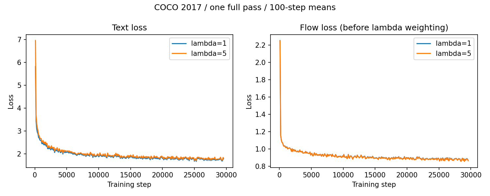

# Transfusion Reproduction

Transfusion 논문의 텍스트·이미지 결합 구조를 Lucidrains의 커뮤니티 구현으로 축소 재현한 프로젝트입니다.
COCO 2017 전체 학습 이미지 118,287장을 λ=1과 λ=5로 각각 한 번 학습하고, validation 5,000장에서 평가했습니다.

## 설정

모델은 width 768, 12-layer Transformer이며 학습 파라미터는 약 314M개입니다.
TinyLlama에서는 tokenizer만 사용하고, 이미지에는 사전학습된 Stable Diffusion VAE를 사용합니다.
이미지 크기 256×256, batch size 4, AdamW 학습률 1e-4, seed 42로 두 실험을 맞췄습니다.
각 실험은 29,572 step이며 이미지 수 제한을 두지 않았습니다. GTX 1080 Ti 11GB에서 각각 약 8.2시간, 8.1시간 걸렸습니다.

## 결과

| COCO validation 5,000장 | λ=1 | λ=5 |
|---|---:|---:|
| Text loss | 1.7440 | 1.7782 |
| Flow loss — λ 적용 전 | 0.8865 | 0.8841 |
| 일반 샘플링에서 이미지 생성 | 3/3 프롬프트 | 3/3 프롬프트 |
| 이미지 시작 토큰을 강제한 경우 | 3/3 프롬프트 | 3/3 프롬프트 |



이전의 텍스트만 생성되던 상태와 달리 일반 샘플링에서도 이미지가 나왔습니다.
다만 생성물의 형태가 흐리고 프롬프트의 대상을 충분히 표현하지 못했습니다.
λ=5의 flow loss가 조금 낮았지만 한 seed의 작은 차이만으로 우수하다고 결론내릴 수는 없습니다.
두 실험은 손실 가중치가 달라 weighted total loss 자체로 성능을 비교하지 않았습니다.


원본 샘플, 검증값, 100-step 단위 요약과 압축된 전체 학습 기록은 [실험 결과](results/coco_full/README.md)에 있습니다.
FID·CLIP score는 계산하지 않았습니다. 표의 3/3은 평가 성능이 아니라 세 프롬프트에서 이미지 파일이 생성됐다는 뜻입니다.

## 실행

Python 3.13.2 가상환경을 만든 뒤 활성화합니다. 아래 GPU 설치는 이번 실험에서 사용한 CUDA 11.8 조합입니다.

```bash
python -m venv .venv
```

가상환경의 Python에서 패키지를 설치합니다.

```bash
python -m pip install torch==2.7.0+cu118 torchvision==0.22.0+cu118 --index-url https://download.pytorch.org/whl/cu118
python -m pip install -r requirements.txt
```

[COCO 준비](data/README.md) 후 저장소 루트에서 실행합니다. 첫 실행에는 tokenizer와 VAE를 다운로드합니다.

```bash
python transfusion-repro/main.py --coco-root data/coco --flow-loss-weight 1 --max-steps 29572 --batch-size 4 --save-every 1000 --keep-checkpoints 3 --results-dir outputs/lambda1
python transfusion-repro/main.py --coco-root data/coco --flow-loss-weight 5 --max-steps 29572 --batch-size 4 --save-every 1000 --keep-checkpoints 3 --results-dir outputs/lambda5
python transfusion-repro/eval_coco_val.py --coco-root data/coco --ckpt outputs/lambda1/model_step_29572.pt --split val --output outputs/lambda1/validation.json
python transfusion-repro/inference.py --ckpt outputs/lambda1/model_step_29572.pt --prompt "A cat sitting on a chair" --seed 42 --max-length 512 --modality-steps 16 --output-dir outputs/lambda1/sample
```

`--resume`에 체크포인트를 지정하면 모델·optimizer·난수 상태·데이터 진행 위치를 복원합니다.
`--keep-checkpoints`는 최근 체크포인트 보관 개수이며, `--stop-file`로 지정한 파일이 생기면 현재 step을 마치고 저장한 뒤 멈춥니다.
`--force-image`는 이미지 시작 토큰을 붙여 보는 디버깅 옵션입니다. 강제 결과와 일반 샘플링을 구분해 저장했습니다.

데이터와 사전학습 모델 없이 작은 결합 학습 경로만 확인하려면 다음 명령을 사용할 수 있습니다.

```bash
python transfusion-repro/main.py --smoke-test --max-steps 5 --batch-size 2 --results-dir outputs/smoke
```

## 논문과 구현 범위

원 논문은 cosine noise schedule의 DDPM noise-prediction loss를 사용합니다.
참고한 Lucidrains 구현은 이를 flow matching으로 대체했습니다. 이번 실험은 velocity 예측(`model_output_clean=False`)을 사용했습니다.
따라서 구조를 참고한 커뮤니티 구현의 축소 실험이며, 원 논문의 학습 방식·데이터 규모·정량 성능 전체를 그대로 재현한 것은 아닙니다.

## References

[1] Zhou et al., "Transfusion: Predict the Next Token and Diffuse Images with One Multi-Modal Model", ICLR 2025. [Paper](https://arxiv.org/abs/2408.11039)

[2] Lucidrains, Transfusion-pytorch Repository. [Code](https://github.com/lucidrains/transfusion-pytorch)
