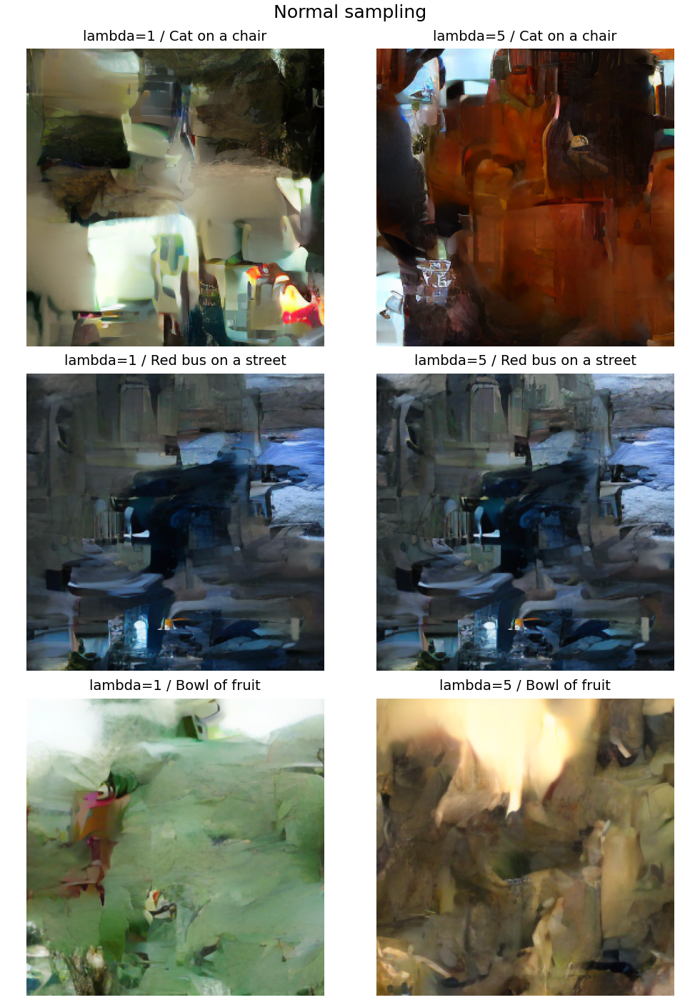
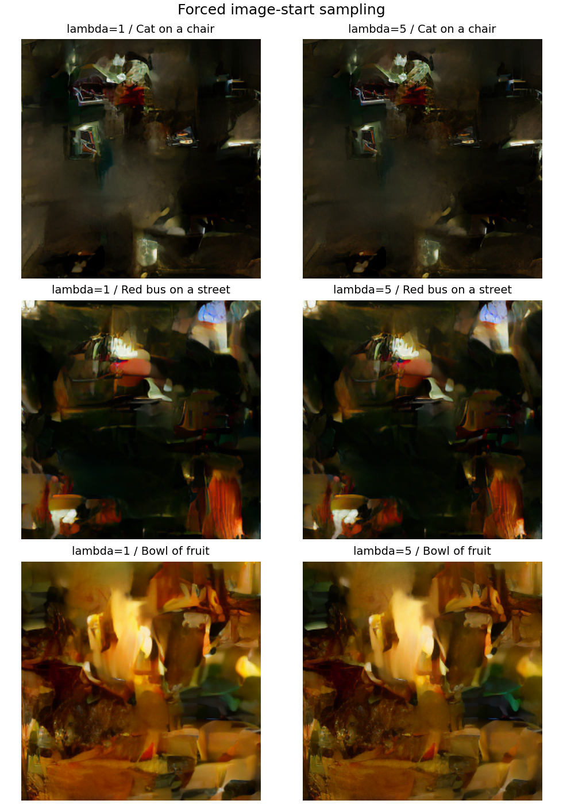

# COCO 전체 학습 결과

2026-10-28부터 2026-10-29까지 λ=1과 λ=5를 각각 118,287장 전체에서 1 epoch 학습했습니다.
두 실험의 설정은 손실 가중치를 제외하면 같으며 첫 step의 text·flow loss도 동일함을 확인했습니다.
모든 29,572개 step 기록이 연속이고 유한한 값인지, 최종 진행 기록의 images_seen이 118,287인지 확인했습니다.

| 항목 | λ=1 | λ=5 |
|---|---:|---:|
| 학습 step | 29,572 | 29,572 |
| 처리한 학습 이미지 | 118,287 | 118,287 |
| 검증 이미지 | 5,000 | 5,000 |
| 검증 text loss | 1.744039 | 1.778247 |
| 검증 flow loss, λ 적용 전 | 0.886515 | 0.884078 |
| 검증 weighted total loss | 0.946525 | 4.186592 |
| 학습 시간 | 8.21시간 | 8.11시간 |

weighted total loss는 λ와 토큰 비율을 반영하므로 다른 λ 사이의 우열 기준으로 쓰지 않습니다.
평가는 두 실험 모두 같은 seed 42와 validation split 전체를 사용했습니다. 한 seed만 실행했으며 반복 실험의 신뢰구간은 없습니다.

## 파일

- `lambda1/`, `lambda5/`: 실제 설정, 최종 진행 기록, validation 결과, 원본 생성 이미지
- `training.csv.gz`: 각 폴더에 보관한 전체 step 기록. `pandas.read_csv()`로 바로 읽을 수 있습니다.
- `training_summary.csv`: 100-step 구간의 평균 손실과 step 범위
- `comparison.json`: 세 프롬프트와 seed, 일반·강제 샘플링 결과
- `environment.json`, `data_manifest.json`, `source_hashes.json`: 실행 환경, 데이터 출처·annotation 해시, 실행 코드 해시
- `checkpoint_manifest.json`: 로컬 최종 체크포인트의 크기와 SHA-256. 가중치 파일 자체는 로컬에 보관합니다.

## 생성 결과

고양이·의자, 빨간 버스·거리, 과일 그릇·탁자 프롬프트를 seed 42·43·44로 비교했습니다.
일반 샘플링과 이미지 시작 토큰을 강제하는 샘플링에서 각각 한 장씩 생성되어 총 12장을 확인했습니다.
샘플링 설정은 max-length 512, modality-steps 16입니다. 샘플러는 시작한 이미지 전체를 마무리하므로 표시 길이가 max-length를 넘을 수 있습니다.

이미지 생성으로 전환되는 경로는 작동하지만 형태와 프롬프트 일치도는 낮습니다.
생성 파일 수를 화질이나 의미 일치도의 성공률로 해석하지 않았고, FID·CLIP 평가도 하지 않았습니다.
원 논문의 DDPM 대신 커뮤니티 flow-matching 구현을 사용한 점도 결과 해석에 포함해야 합니다.
